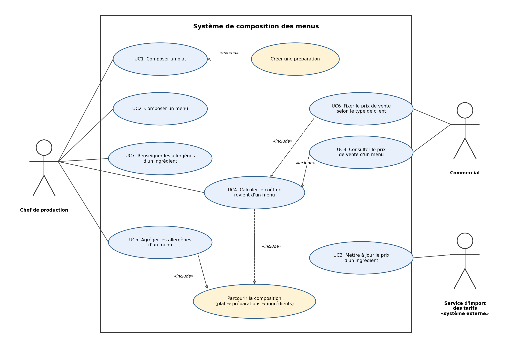
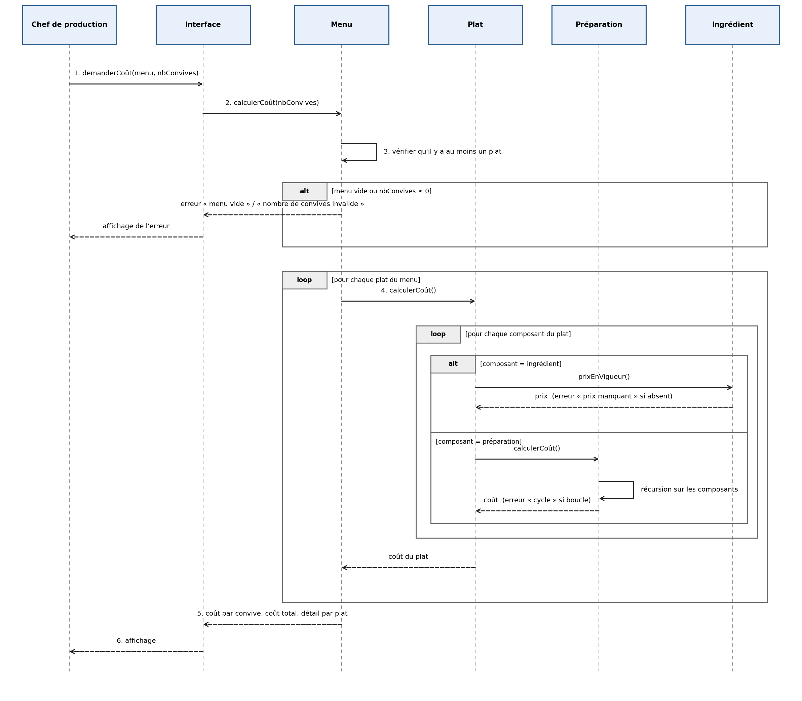

# TD 1 · Analyse — Sujet C : La composition des menus

> **Livrable 1.** Un seul fichier, dans le dépôt GitLab de l'équipe.
> **Parties 1 à 3 :** poussées pendant la séance du mardi 3 novembre.
> **Parties 4 à 11 :** poussées avant le vendredi 6 novembre à 12h00.
> En cas de problème GitLab : ce fichier par mail, avant la même heure.
> Si ce n'est pas demandé dans ce modèle, ce n'est pas demandé.

---

## 1. Équipe et sujet

**Sujet :** C — La composition des menus (client : Karim T., chef de production, traiteur)

**Équipe jumelle :**

| Membre | Use case riche | Use case simple |
|---|---|---|
| Manele Hssini|UC4 — Calculer le coût de revient d'un menu |	UC1 — Enregistrer un ingrédient |
| Abir Guebbache | UC2 — Composer une recette (plat ou préparation de base) | UC3 — Mettre à jour le prix d'un ingrédient |
| Tania Hussain |UC5 — Établir la liste des allergènes d’un menu | UC7 — Modifier le prix d’un ingrédient |
| Mohamed Amine BARCHAH | UC8 — Fixer le prix de vente d'un menu selon le type de client | UC6 — Composer un menu

---

## 2. Nos questions à la cliente

*8 questions maximum. Une question = un point flou, dans les mots du client, et une décision qui en dépend.*

| # | Question | Type de flou | Ce que la réponse débloque |
|---|---|---|---|
| Q1 |Le « coût de revient » d'un menu, c'est seulement le coût des ingrédients, ou faut-il aussi compter la main-d'œuvre, l'énergie et les pertes ? |	non-dit  | La formule de calcul du coût (RM sur le coût de revient, UC4).|
| Q2 | Quand « une sauce entre dans trois plats », comment indiquez-vous la quantité utilisée dans chaque plat, et une préparation a-t-elle un rendement (pertes à la cuisson, quantité produite par recette) ?| ambiguïté  | 	Le calcul récursif : on prend une part de la sauce au prorata de la quantité utilisée (UC2, UC4).|
| Q3 | Quand le prix d'un ingrédient change chez le fournisseur, le coût des menus déjà proposés ou vendus à un client doit-il changer aussi, ou garde-t-on le prix du jour du devis ? | contrainte cachée | Faut-il garder l'historique des prix des ingrédients et figer le coût d'un menu au moment du devis (UC3, UC4). |
| Q4 | Une recette est-elle écrite pour un nombre de portions fixe, et faut-il recalculer les quantités automatiquement selon le nombre de couverts d'une commande ? | non-dit | Ce qu'on enregistre dans une recette (quantités pour N portions) et la règle de mise à l'échelle des quantités (UC2, UC5). |
| Q5 | Quand vous « composez des menus pour des événements », un menu est-il organisé en services (entrée, plat, dessert) avec plusieurs choix possibles par service, ou c'est une simple liste de plats ? | ambiguïté | La structure d'un menu et la façon de calculer son coût par couvert (UC5, UC4). |
| Q6 | Le nombre de couverts d'un événement peut-il changer une fois le menu composé (invités en plus, annulations) ? Jusqu'à quand ? | non-dit | Faut-il recalculer quantités et coût, et à partir de quand le menu est figé (UC6, UC4). |
| Q7 | Qu'est-ce qui différencie exactement un client « entreprise » d'un « particulier » (coefficient de marge différent, TVA, remise selon le volume) ? | ambiguïté | La formule de calcul du prix de vente (UC8, RM sur les prix). |
| Q8 | Les nouveaux prix des ingrédients doivent-ils être saisis à la main, ou proviennent-ils d'un fichier/logiciel externe (fournisseur) ? | non-dit | L'identification d'un acteur non humain et le mécanisme d'import (UC3, UC7). | 
---

## 3. Nos hypothèses

*Pour chaque point flou, l'hypothèse que vous prenez pour avancer sans réponse.*

| # | Nous supposons que… | parce que… | Si c'est faux, cela change… |
|---|---|---|---|
| H1 |	le coût de revient ne compte que le coût des ingrédients | c'est le seul coût que le mail permet de relier aux plats|la formule de UC4 : il faut ajouter des coûts fixes ou horaires par recette. |
| H2 | le commercial fixe le prix en appliquant un simple coefficient multiplicateur sur le coût de revient selon le type de client | la cliente demande une politique de prix selon le client mais ne mentionne aucune règle complexe de remise | le scénario nominal de l'UC8 : il faudrait développer un moteur de règles tarifaires beaucoup plus lourd. |
| H3 | la composition d'un menu se fait uniquement en sélectionnant des plats standards, sans modifier les ingrédients pour cet événement | le besoin évoque l'assemblage de plats, ce qui implique de réutiliser les fiches techniques telles quelles | la structure de l'UC6 : le système devrait créer une copie indépendante de la recette pour chaque menu. |
| H4 | le prix de vente fixé pour un menu est définitivement figé une fois validé par le commercial, même si le coût des ingrédients fluctue | un devis communiqué à un client engage commercialement le traiteur, le prix ne peut plus bouger | le comportement de l'UC8 : il faudrait gérer des alertes de marge et des mises à jour dynamiques des devis. |
| H5 | un menu est une liste de plats répartis en services (entrée, plat, dessert), avec un seul choix par service, pour un nombre de couverts donné | c'est le cas le plus simple qui couvre un événement, et le mail ne parle pas de choix | il faudrait gérer des options par service, et le coût deviendrait une fourchette ou une moyenne |
| H6 | le nombre de couverts reste modifiable jusqu'à la validation du devis, et les quantités et le coût sont alors recalculés | un événement change souvent de taille avant la date, mais un devis signé ne doit plus bouger | il faudrait gérer des versions du menu ou des avenants au devis |
---
## 4. Les acteurs

*Qui déclenche une interaction avec le système. Au moins un acteur n'est pas humain.*

| Acteur | Humain ? | Ce qu'il veut obtenir |
|---|---|---|
| Chef de production (Karim T.) | oui | Composer des plats et des menus, calculer leur coût de revient et gérer la liste de leurs allergènes. |
| Commercial | oui | Consulter et fixer les prix de vente des menus pour les devis en appliquant la politique tarifaire par client. |
| Système fournisseur | non | Transmettre et mettre à jour automatiquement les prix d'achat des ingrédients dans le système. |

---

## 5. Les use cases

*Format « verbe + complément », du point de vue de l'acteur. 6 à 8 pour l'équipe.*

| # | Use case | Acteur principal | Porteur |
|---|---|---|---|
| UC1 | Enregistrer un ingrédient | Chef de production | Manele HSSINI |
| UC2 | Composer une recette (plat ou préparation de base) | Chef de production | Abir GUEBBACHE |
| UC3 | Mettre à jour le prix d'un ingrédient | Système fournisseur | Abir GUEBBACHE |
| UC4 | Calculer le coût de revient d'un menu | Chef de production | Manele HSSINI |
| UC5 | Établir la liste des allergènes d’un menu | Chef de production | Tania HUSSAIN |
| UC6 | Composer un menu | Chef de production | Mohamed Amine BARCHAH |
| UC7 | Modifier le prix d’un ingrédient | Chef de production | Tania HUSSAIN |
| UC8 | Fixer le prix de vente d'un menu selon le type de client | Commercial | Mohamed Amine BARCHAH |

**Diagramme de use cases**

*Dessiné dans draw.io : le rectangle du système, les acteurs dehors, include et extends. Exportez-le en PNG dans le dossier `diagrammes/` du dépôt.*

---

## 6. Les fiches use case

*Une fiche par use case, 2 par personne. Au moins deux scénarios d'erreur par fiche. Copiez le modèle ci-dessous autant de fois que nécessaire.*

### UC… — [verbe + complément]

- **Auteur :**
- **Acteur principal :**
- **Acteurs secondaires :**
- **Objectif :**
- **Préconditions :**

**Scénario nominal**

1.
2.
3.

**Scénarios alternatifs**

- 1a.

**Scénarios d'erreur**

- 2e.
- 3e.

**Règles métier appliquées :** RM…

---

### UC1 — Enregistrer un ingrédient

- **Auteur :** Manele HSSINI
- **Acteur principal :** Chef de production (Karim T.)
- **Acteurs secondaires :** Aucun
- **Objectif :** Ajouter un produit acheté (beurre, saumon, œufs…) avec son prix, son unité d'achat, s'il est frais ou non, et ses allergènes, pour pouvoir ensuite l'utiliser dans les recettes.
- **Préconditions :** La liste des 14 allergènes réglementaires est connue du système.

**Scénario nominal**

1. Le Chef de production demande à enregistrer un nouvel ingrédient.
2. Le système demande le nom, l'unité d'achat (kilo, litre ou pièce), le prix d'achat, si l'ingrédient est frais, et ses allergènes.
3. Le Chef saisit le nom, l'unité d'achat et le prix (ex. beurre doux, 9,80 € le kilo).
4. Le Chef indique si l'ingrédient est frais (légume, poisson, viande) ou non.
5. Le Chef coche les allergènes de l'ingrédient dans la liste des 14, ou indique « aucun allergène » (ex. beurre doux : lait).
6. Le système vérifie que le nom n'est pas déjà pris, que le prix est valide et que l'unité fait partie des trois autorisées (RM13, RM14, RM17).
7. Le système enregistre l'ingrédient. Le prix saisi devient son prix en vigueur à partir d'aujourd'hui (RM15).
8. Le système confirme l'enregistrement. L'ingrédient peut maintenant être choisi comme composant d'une recette (UC2).

**Scénarios alternatifs**

- 1a. **Depuis une recette :** le Chef est en train de composer une recette et l'ingrédient n'existe pas encore (UC2, 4e). Il l'enregistre ici, puis revient à sa recette là où il en était.
- 3a. **Prix pas encore connu :** le Chef n'a pas encore le tarif du fournisseur. Le système enregistre l'ingrédient sans prix et le marque « prix manquant ». Les recettes qui l'utilisent auront un coût incomplet tant que le prix n'est pas saisi (UC7) ou reçu (UC3).
- 5a. **Allergènes pas encore connus :** la fiche du fournisseur n'est pas arrivée. Le Chef laisse la liste vide ; le système marque l'ingrédient « allergènes à compléter », ce qui n'est pas la même chose que « aucun allergène » (RM18).

**Scénarios d'erreur**

- 3e. **Nom déjà utilisé :** un ingrédient porte déjà ce nom (ex. deux fois « crème fraîche »). Le système refuse et affiche l'ingrédient existant pour que le Chef vérifie s'il s'agit du même produit (RM17).
- 3e'. **Prix invalide :** le prix saisi est nul ou négatif. Le système refuse et redemande le prix (RM13).
- 3e''. **Unité non autorisée :** le Chef saisit une autre unité (ex. « botte », « barquette »). Le système refuse et lui demande de choisir entre kilo, litre et pièce (RM14).

**Règles métier appliquées :** RM13, RM14, RM15, RM17, RM18

---

### UC2 — Composer une recette (plat ou préparation de base)

- **Auteur :** Abir GUEBBACHE
- **Acteur principal :** Chef de production (Karim T.)
- **Acteurs secondaires :** Aucun
- **Objectif :** Décrire un plat (servi pour une portion) ou une préparation faite maison (ex. 1 litre de sauce hollandaise) avec ses composants et leurs quantités, pour pouvoir la réutiliser dans d'autres plats et dans les menus, et en connaître le coût de revient et les allergènes.
- **Préconditions :** Les ingrédients utilisés sont déjà enregistrés avec leur prix et leurs allergènes (UC1). Les préparations utilisées comme composant sont déjà enregistrées.

**Scénario nominal**

1. Le Chef de production demande à créer une nouvelle recette.
2. Le système demande le nom de la recette et son type : plat (pour une portion) ou préparation (avec la quantité produite, ex. 1 L).
3. Le Chef saisit ces informations.
4. Le Chef ajoute un composant : il choisit un ingrédient ou une préparation existante et indique la quantité utilisée avec son unité (kg, g, L, cL, pièce).
5. Le système vérifie que le composant existe, que la quantité est valide et que l'unité est compatible avec celle du composant (RM7, RM8).
6. Le Chef répète les étapes 4 et 5 pour chaque composant.
7. Le Chef valide la recette.
8. Le système enregistre la recette, puis affiche son coût de revient (au prorata des quantités, pertes de 10 % comprises sur les ingrédients frais) et la liste de ses allergènes, à tous les niveaux (RM10, RM11, RM12).

**Scénarios alternatifs**

- 1a. **Variante d'une recette :** le Chef part d'une recette existante, le système en fait une copie sous un nouveau nom que le Chef modifie.
- 4a. **Composant = préparation :** le Chef ajoute une préparation (ex. 5 cL de sauce hollandaise). Le système compte seulement la part utilisée, au prorata de la quantité produite par la préparation (RM10).
- 6a. **Correction avant validation :** le Chef modifie la quantité d'un composant ou le retire. Le système met à jour la composition et le coût affiché.

**Scénarios d'erreur**

- 3e. **Nom déjà utilisé :** une recette porte déjà ce nom. Le système refuse et demande un autre nom (RM9).
- 4e. **Composant inconnu :** l'ingrédient cherché n'est pas enregistré. Le système le signale et propose de l'enregistrer d'abord (UC1).
- 5e. **Quantité ou unité invalide :** la quantité est nulle ou négative, ou l'unité n'est pas compatible (ex. des litres pour des œufs vendus à la pièce). Le système refuse le composant (RM8).
- 5e'. **Boucle :** le Chef ajoute une préparation qui contient déjà, directement ou indirectement, la recette en cours (la sauce A contient la sauce B qui contient la sauce A). Le système refuse le composant (RM7).
- 7e. **Recette vide :** le Chef valide sans aucun composant. Le système refuse la validation (RM6).
- 8e. **Données manquantes :** un ingrédient de la recette, à n'importe quel niveau, n'a pas de prix ou pas de liste d'allergènes renseignée. Le système enregistre la recette mais signale que son coût et ses allergènes sont incomplets, et indique l'ingrédient en cause.

**Règles métier appliquées :** RM6, RM7, RM8, RM9, RM10, RM11, RM12

---

### UC3 — Mettre à jour le prix d'un ingrédient

- **Auteur :** Abir GUEBBACHE
- **Acteur principal :** Système fournisseur (acteur non humain : tarif transmis par le logiciel du fournisseur)
- **Acteurs secondaires :** Chef de production (confirme les variations anormales)
- **Objectif :** Garder le prix d'achat des ingrédients à jour pour que le coût de revient de tous les plats et menus qui les utilisent reste juste.
- **Préconditions :** L'ingrédient est déjà enregistré avec son unité d'achat (kilo, litre ou pièce) (UC1).

**Scénario nominal**

1. Le Système fournisseur transmet un nouveau prix pour un ingrédient (référence de l'ingrédient, prix, unité d'achat, date d'application).
2. Le système retrouve l'ingrédient et son prix actuel (ex. saumon : 18,50 € le kg).
3. Le système vérifie le nouveau prix et son unité (RM13, RM14).
4. Le système enregistre le nouveau prix comme prix en vigueur à partir de la date d'application et conserve l'ancien dans l'historique (RM15).
5. Le système recalcule le coût de revient de toutes les préparations, plats et menus qui utilisent cet ingrédient, à tous les niveaux (RM16).
6. Le système signale au Chef de production la liste des plats et menus dont le coût a changé.

**Scénarios alternatifs**

- 1a. **Saisie manuelle :** le prix est reçu sur une facture papier. Le Chef de production saisit lui-même le nouveau prix (cf. UC7), la suite est identique à partir de l'étape 3.
- 3a. **Changement de conditionnement :** le fournisseur passe du kilo à la pièce (ex. carton de 6). Le système convertit le prix dans l'unité d'achat de l'ingrédient si la conversion est connue, sinon il demande au Chef de la renseigner.

**Scénarios d'erreur**

- 2e. **Ingrédient inconnu :** la référence transmise ne correspond à aucun ingrédient enregistré. Le système rejette la ligne et la signale au Chef, qui peut enregistrer l'ingrédient (UC1).
- 3e. **Prix invalide :** le prix est vide, nul ou négatif. Le système rejette la mise à jour et garde l'ancien prix (RM13).
- 3e'. **Variation anormale :** le nouveau prix est très éloigné de l'ancien (ex. multiplié par 10, erreur de virgule). Le système met la mise à jour en attente et demande une confirmation au Chef de production avant de l'appliquer.
- 4e. **Date incohérente :** la date d'application est antérieure à celle du dernier prix enregistré. Le système rejette la mise à jour (RM15).

**Règles métier appliquées :** RM13, RM14, RM15, RM16

---
### UC4 — Calculer le coût de revient d'un menu

- **Auteur :** Manele HSSINI
- **Acteur principal :** Chef de production (Karim T.)
- **Acteurs secondaires :** Aucun (le Commercial utilise ensuite le résultat dans UC8)
- **Objectif :** Savoir combien coûte un menu pour un événement, en descendant dans chaque plat, chaque préparation et chaque ingrédient, pertes comprises, pour pouvoir ensuite fixer un prix de vente qui ne fasse pas perdre d'argent.
- **Préconditions :** Le menu existe et contient au moins un plat (UC6). Les plats du menu sont composés (UC2).

**Scénario nominal**

1. Le Chef de production choisit un menu et saisit le nombre de couverts de l'événement (ex. mariage, 120 couverts).
2. Le système vérifie que le nombre de couverts est strictement positif (RM2).
3. Pour chaque plat du menu, le système reprend sa composition. Pour chaque ingrédient, il convertit la quantité dans l'unité d'achat (ex. 150 g → 0,150 kg) et la multiplie par le prix en vigueur à la date du jour (RM15, RM20).
4. Le système ajoute 10 % au coût des ingrédients frais (RM11).
5. Pour chaque préparation utilisée dans un plat, le système calcule d'abord le coût de toute la préparation de la même façon, à tous les niveaux, puis ne garde que la part utilisée (RM10). Ex. la sauce hollandaise coûte 6,40 € le litre ; le plat en utilise 5 cL, donc 0,32 €.
6. Le système additionne les composants pour obtenir le coût d'une portion de chaque plat, puis additionne les plats pour obtenir le coût par couvert du menu (RM19).
7. Le système multiplie le coût par couvert par le nombre de couverts pour obtenir le coût total (RM19).
8. Le système affiche le détail : coût d'une portion de chaque plat, coût par couvert, coût total, et la date des prix utilisés.
9. Le système garde ce calcul (menu, nombre de couverts, date, coût) pour que le Commercial puisse s'en servir pour fixer le prix de vente (UC8).

**Scénarios alternatifs**

- 1a. **Coût par couvert seulement :** le Chef ne connaît pas encore le nombre de couverts. Il ne saisit rien ; le système fait le calcul pour un couvert et s'arrête à l'étape 6.
- 3a. **Prix à une autre date :** le Chef veut le coût avec les prix en vigueur à une date passée (ex. pour comparer avec un devis de septembre). Le système utilise l'historique des prix à cette date (RM15).
- 8a. **Prix changé depuis le dernier calcul :** un prix d'ingrédient a changé depuis le dernier calcul de ce menu (UC3, UC7). Le système affiche l'ancien et le nouveau coût par couvert pour que le Chef voie l'écart (RM16).

**Scénarios d'erreur**

- 2e. **Nombre de couverts invalide :** le Chef saisit 0 ou un nombre négatif. Le système refuse et redemande le nombre de couverts (RM2).
- 3e. **Ingrédient sans prix :** un ingrédient, à n'importe quel niveau, n'a pas de prix en vigueur. Le système calcule quand même le reste mais affiche le coût comme « incomplet », avec le nom de l'ingrédient et le plat concerné. Ce coût ne peut pas servir à fixer un prix de vente (RM3).
- 3e'. **Conversion impossible :** la quantité est dans une unité qu'on ne peut pas ramener à l'unité d'achat (ex. 200 g de citron alors que le citron est acheté à la pièce). Le système ne peut pas chiffrer cette ligne ; il signale l'ingrédient et la recette en cause, et le coût est affiché comme « incomplet » (RM8, RM20).
- 6e. **Plat retiré :** un plat du menu a été supprimé depuis la composition du menu. Le système le signale et ne calcule pas le coût tant que le menu n'a pas été corrigé (UC6).

**Règles métier appliquées :** RM2, RM3, RM8, RM10, RM11, RM15, RM16, RM19, RM20

---
### UC5 — Établir la liste des allergènes d'un menu

- **Auteur :** Tania HUSSAIN
- **Acteur principal :** Chef de production (Karim T.)
- **Acteurs secondaires :** Commercial (remet la liste au client)
- **Objectif :** Obtenir la liste complète et sûre des allergènes d'un menu, en descendant dans chaque plat, chaque préparation et chaque ingrédient, pour informer le client comme la loi l'exige.
- **Préconditions :** Le menu existe et contient au moins un plat (UC6). Les plats du menu sont composés (UC2).

**Scénario nominal**

1. Le Chef de production choisit un menu et demande la liste de ses allergènes.
2. Pour chaque plat du menu, le système reprend sa composition. Pour chaque préparation, il descend dans sa composition, à tous les niveaux (même une sauce dans une sauce).
3. Pour chaque ingrédient atteint, le système relève ses allergènes parmi les 14 allergènes réglementaires (RM23).
4. Le système vérifie que chaque ingrédient a sa liste d'allergènes renseignée, ou est marqué « aucun allergène » (RM18, RM22).
5. Le système retient un allergène dès qu'un seul composant le contient, à n'importe quel niveau (RM12, RM21). Ex. saumon sauce hollandaise : poisson (saumon), œufs et lait (jaunes d'œufs et beurre de la hollandaise).
6. Le système affiche la liste des allergènes du menu, plat par plat puis pour le menu entier.
7. Le Chef valide la liste. Le système l'enregistre avec sa date (RM24) ; le Commercial peut la remettre au client.

**Scénarios alternatifs**

- 6a. **Aucun allergène :** tous les ingrédients du menu sont marqués « aucun allergène ». Le système affiche « aucun des 14 allergènes réglementaires », ce qui n'est pas la même chose qu'une liste vide (RM18).
- 6b. **Origine d'un allergène :** le Chef veut savoir d'où vient un allergène. Le système affiche le chemin complet (ex. Filet de saumon → Sauce hollandaise → Beurre → lait).
- 7a. **Liste à refaire :** un ingrédient du menu a été modifié depuis la dernière liste. Le Chef relance le calcul ; la nouvelle liste remplace l'ancienne (RM24).

**Scénarios d'erreur**

- 4e. **Allergènes non renseignés :** un ingrédient, à n'importe quel niveau, est marqué « allergènes à compléter ». Le système n'établit pas la liste, affiche l'ingrédient et le plat concerné, et propose de compléter sa fiche (UC1). On ne devine jamais un allergène (RM22).
- 2e. **Plat retiré :** un plat du menu a été supprimé depuis la composition du menu. Le système le signale et n'établit pas la liste tant que le menu n'a pas été corrigé (UC6, RM1).
- 7e. **Ingrédient modifié après validation :** les allergènes d'un ingrédient changent après que la liste a été validée (nouvelle fiche fournisseur). Le système marque la liste « à revoir » et prévient le Chef ; elle ne peut plus être remise au client tant qu'elle n'est pas refaite (RM24).

**Règles métier appliquées :** RM1, RM12, RM18, RM21, RM22, RM23, RM24

---

### UC6 — Composer un menu

- **Auteur :** Mohamed Amine BARCHAH
- **Acteur principal :** Chef de production
- **Acteurs secondaires :** Aucun
- **Objectif :** Créer un nouveau menu destiné à être vendu pour des événements en y associant des plats existants.
- **Préconditions :** Les recettes (plats) doivent être préalablement créées dans le système (UC2).

**Scénario nominal**

1. Le Chef de production demande la création d'un nouveau menu et saisit son nom.
2. Le système affiche la liste des plats disponibles.
3. Le Chef sélectionne un ou plusieurs plats et valide la composition.
4. Le système enregistre le menu et affiche un message de confirmation.

**Scénarios alternatifs**

- 3a. **Retrait d'un plat :** Avant de valider, le Chef retire un plat sélectionné par erreur. Le système met à jour la composition temporaire.

**Scénarios d'erreur**

- 3e. **Menu vide :** Le Chef tente de valider le menu sans avoir sélectionné aucun plat. Le système bloque l'action et affiche l'erreur « menu vide » (RM1).
- 2e. **Plat introuvable :** Le Chef cherche un plat qui n'existe pas ou a été supprimé. Le système indique qu'aucun résultat ne correspond.

**Règles métier appliquées :** RM1

---

### UC8 — Fixer le prix de vente d'un menu selon le type de client

- **Auteur :** Mohamed Amine BARCHAH
- **Acteur principal :** Commercial
- **Acteurs secondaires :** Aucun
- **Objectif :** Définir le prix de vente d'un menu en appliquant la politique tarifaire adaptée au profil du client.
- **Préconditions :** Le menu doit exister (UC6) et son coût de revient total doit avoir pu être calculé (UC4).

**Scénario nominal**

1. Le Commercial sélectionne un menu existant et saisit un nombre de convives cible.
2. Le système calcule et affiche le coût de revient total pour ce nombre de convives.
3. Le Commercial sélectionne le type de client (Entreprise ou Particulier).
4. Le système calcule le prix de vente théorique en appliquant le coefficient lié au type de client (RM4).
5. Le Commercial valide ou ajuste manuellement le prix de vente final.
6. Le système enregistre le prix de vente associé à ce menu pour ce profil.

**Scénarios alternatifs**

- 5a. **Ajustement manuel :** Le Commercial saisit un prix différent du prix théorique. Le système affiche la nouvelle marge générée avant validation.

**Scénarios d'erreur**

- 1e. **Nombre de convives invalide :** Le Commercial saisit 0 ou un nombre négatif. Le système bloque le calcul et affiche l'erreur « nombre de convives invalide » (RM2).
- 2e. **Coût incalculable :** Le système détecte un ingrédient sans prix en vigueur dans la composition du menu. Le système bloque la tarification et affiche l'erreur « prix manquant » (RM3).

**Règles métier appliquées :** RM2, RM3, RM4, RM5

---

## 7. Les règles métier

*Une règle par ligne, numérotée. Le test : avec un gardien et un carnet, sans aucun logiciel, la règle reste vraie.*

| # | Règle métier | Use cases qui l'appliquent |
|---|---|---|
| RM1 | Un menu doit impérativement contenir au moins un plat pour être valide et sauvegardé. | UC6 |
| RM2 | Le nombre de convives renseigné pour tarifer un menu doit toujours être strictement positif (> 0). | UC8 |
| RM3 | Le prix de vente d'un menu ne peut pas être fixé si l'un de ses ingrédients ne possède pas de prix en vigueur (coût incalculable). | UC8 |
| RM4 | Le prix de vente théorique est calculé en appliquant un coefficient multiplicateur lié au type de client sur le coût de revient total : × 3 pour une entreprise, × 2,5 pour un particulier. | UC8 |
| RM5 | Le prix de vente final fixé par le commercial doit être supérieur ou égal au coût de revient (interdiction stricte de vendre à perte). | UC8 |
| RM6 | Une recette (plat ou préparation) contient au moins un composant (ingrédient ou préparation). | UC2 |
| RM7 | Une préparation ne peut jamais se contenir elle-même, ni directement ni indirectement (via une autre préparation). | UC2 |
| RM8 | Chaque quantité d'un composant est strictement positive et exprimée dans une unité compatible avec son unité d'achat (kilo, litre ou pièce). | UC2 |
| RM9 | Deux recettes ne peuvent pas porter le même nom. | UC2 |
| RM10 | Le coût d'une préparation utilisée dans une recette est compté au prorata de la quantité utilisée par rapport à la quantité qu'elle produit. | UC2, UC4 |
| RM11 | On ajoute 10 % au coût des ingrédients frais (légumes, poisson, viande) pour couvrir les pertes. | UC2, UC4 |
| RM12 | Une recette contient un allergène dès qu'un seul de ses composants le contient, à n'importe quel niveau (même une sauce dans une sauce). | UC2, UC5 |
| RM13 | Le prix d'achat d'un ingrédient est strictement positif. | UC3, UC7 |
| RM14 | Le prix d'achat d'un ingrédient est exprimé au kilo, au litre ou à la pièce. | UC3, UC1 |
| RM15 | Un ingrédient a un seul prix en vigueur à une date donnée ; un nouveau prix ne peut pas s'appliquer avant le dernier prix enregistré, et l'ancien prix est conservé dans l'historique. | UC3, UC7 |
| RM16 | Quand le prix d'un ingrédient change, le coût de toutes les préparations, plats et menus qui l'utilisent, à tous les niveaux, change aussi. | UC3, UC4, UC7 |

---

## 8. Ce que l'équipe jumelle nous a fait voir

*Ce qu'elle a trouvé chez vous : 1 acteur oublié, 3 cas d'erreur oubliés, 1 hypothèse discutable. Et ce que vous avez changé.*

| Ce qu'elle nous a fait voir | Ce qu'on a changé |
|---|---|
| Acteur oublié : l'équipe de Kadiatou a un acteur non humain « Logiciel du fournisseur » qui met à jour **les prix et les allergènes** des ingrédients. Notre « Système fournisseur » ne transmettait que les prix. | Le Système fournisseur reste l'acteur principal de UC3 ; nous notons qu'il peut aussi transmettre les allergènes d'un ingrédient (point à confirmer avec la cliente, voir partie 10). |
| Cas d'erreur oublié : un ingrédient dont la liste d'allergènes n'est pas renseignée (l'équipe a un UC « Consulter les allergènes d'un menu » séparé). Sans cette liste, les allergènes du menu sont faux. | Ajout du contrôle à la validation d'une recette (UC2) : le coût et les allergènes ne sont affichés que si chaque ingrédient a son prix et sa liste d'allergènes (RM12). |
| Cas d'erreur oublié : une préparation qui se contient elle-même (l'équipe a un UC « Créer une préparation » séparé de « Composer un plat »). | Ajout du scénario d'erreur 5e' « boucle » dans UC2 et de la règle RM7. |
| Cas d'erreur oublié : le fournisseur envoie un prix pour un ingrédient inconnu du système, ou un prix aberrant. | Ajout des scénarios 2e « ingrédient inconnu » et 3e' « variation anormale » dans UC3. |
| Hypothèse discutable : notre H4/Q3 (figer le coût au moment du devis). L'équipe de Kadiatou n'en parle pas, et la cliente a répondu que si un prix change, le coût de tous les plats et menus change aussi. | UC3 recalcule le coût de tout ce qui utilise l'ingrédient (RM16). Le figement du prix de vente d'un devis signé reste une question ouverte (partie 10). |

**Autres différences avec l'équipe de Kadiatou :**

- Ils séparent « Composer un plat » (UC5) et « Créer une préparation » (UC6) ; nous les avons réunis dans UC2 « Composer une recette » car ils ont le même scénario (des composants avec des quantités).
- Leur acteur Commercial veut « connaître le prix de vente d'un menu selon le type de client » (UC8) : même besoin que notre UC8.
- Ils n'ont pas d'UC de saisie manuelle du prix par le Chef ; nous avons UC7 en plus de UC3 pour le cas d'une facture papier.

---

## 9. Glossaire du domaine

*10 termes du métier de votre client, avec leur définition. Les mots du client, pas ceux de l'informatique.*

| Terme | Définition |
|---|---|
| Ingrédient | Un produit acheté (beurre, farine, saumon…). Il a un prix d'achat au kilo, au litre ou à la pièce, et une liste d'allergènes. |
| Ingrédient frais | Un ingrédient qui s'abîme vite : légumes, poisson, viande. On compte 10 % de pertes sur son coût. |
| Préparation | Une recette faite chez nous à partir d'ingrédients et parfois d'autres préparations, avec des quantités (ex. 1 litre de sauce hollandaise). Elle peut entrer dans plusieurs plats. |
| Plat | Ce qui est servi : il est composé d'ingrédients et de préparations, pour une portion. |
| Menu | Une suite de plats (entrée, plat, dessert…) commandée pour un nombre de couverts. |
| Composant | Ce qui entre dans une préparation ou un plat : un ingrédient ou une préparation, avec sa quantité. |
| Couvert | Une personne servie lors d'un événement. Le nombre de couverts fixe la quantité de chaque plat à produire. |
| Coût de revient | La somme des coûts de chaque composant, au prorata des quantités utilisées, à tous les niveaux, pertes comprises. |
| Pertes | Ce qu'on jette ou qu'on perd en préparant les produits frais ; compté comme 10 % du coût des ingrédients frais. |
| Allergène | Une des 14 substances réglementaires qui doivent être signalées au client (gluten, lait, œufs, poisson…). |
| Prix de vente | Le prix proposé au client : coût de revient × 3 pour une entreprise, × 2,5 pour un particulier. |
| Remise | Réduction que le commercial voudrait accorder aux gros clients (forme pas encore décidée). |

---

## 10. Confrontation avec les réponses de la cliente

*À faire après la publication des réponses, mardi soir. Pour chaque question (Q) et chaque hypothèse (H).*

| Q ou H | Réponse de la cliente | Vu / Raté / Ouvert | Ce qu'on a changé dans le fichier |
|---|---|---|---|
| Q1 | Le coût de revient est la somme des coûts des composants au prorata, à tous les niveaux, **plus 10 % de pertes sur les ingrédients frais**. Rien sur la main-d'œuvre ni l'énergie. | Vu | Ajout de RM11 (pertes de 10 %), appliquée dans UC2 et UC4. |
| Q2 | Une préparation a une quantité produite (ex. 1 L de sauce hollandaise) et entre dans plusieurs plats ; le coût est compté au prorata des quantités utilisées. | Vu | UC2 : une préparation a une quantité produite (étape 2) ; RM10 (prorata). |
| Q3 | Si un prix d'ingrédient change, le coût de tous les plats et menus qui l'utilisent change aussi. Rien sur les devis déjà envoyés. | Vu / Ouvert | UC3 étape 5 et RM16 : recalcul de tout ce qui utilise l'ingrédient. L'historique des prix est gardé (RM15). Le cas des devis signés reste ouvert. |
| Q4 | Un plat est décrit pour une portion ; un menu est commandé pour un nombre de couverts. | Vu | UC2 : un plat est saisi pour une portion. Les quantités et le coût d'un menu = portion × nombre de couverts (UC4, UC8). |
| Q5 | Un menu est une suite de plats (entrée, plat, dessert…). Rien sur plusieurs choix par service. | Vu | Aucun changement : H5 est conservée. |
| Q6 | Pas de réponse. | Ouvert | Aucun changement : H6 est conservée. |
| Q7 | Prix de vente = coût de revient × 3 pour une entreprise, × 2,5 pour un particulier. Les remises aux gros clients ne sont pas décidées. | Vu / Ouvert | RM4 : coefficients 3 et 2,5 précisés. Les remises restent hors périmètre pour l'instant. |
| Q8 | Pas de réponse directe ; le prix d'achat est au kilo, au litre ou à la pièce. | Ouvert | UC3 garde le Système fournisseur comme acteur et la saisie manuelle en alternative (1a, UC7) ; ajout de RM14 (unités). |
| H1 | Faux en partie : il faut ajouter 10 % de pertes sur les ingrédients frais. | Raté | Formule du coût de revient corrigée (RM11). |
| H2 | Confirmé : un coefficient selon le type de client (× 3 / × 2,5). | Vu | RM4 précisée. |
| H3 | Pas de réponse ; un plat est « ce qui est servi », réutilisé tel quel. | Vu | Aucun changement. |
| H4 | La cliente dit que le coût change avec les prix ; elle ne dit rien du prix d'un devis déjà validé. | Ouvert | Le coût de revient est toujours recalculé (RM16) ; le prix de vente validé reste figé en attendant une réponse. |
| H5 | Confirmé : une suite de plats pour un nombre de couverts. | Vu | Aucun changement. |
| H6 | Pas de réponse. | Ouvert | Aucun changement. |

**Ce que nous n'avions pas vu :**

- Les 10 % de pertes sur les ingrédients frais (légumes, poisson, viande) dans le coût de revient.
- Les allergènes : un menu contient un allergène dès qu'un seul composant le contient, même « une sauce dans une sauce », sur la liste des 14 allergènes réglementaires.
- Le prix d'achat a trois unités possibles : kilo, litre ou pièce.
- Le suivi des stocks est hors périmètre pour cette année.

**Ce qui reste ouvert après les réponses :**

- La forme des remises aux gros clients : pourcentage ou prix négocié par client ?
- Le prix d'un devis déjà validé doit-il bouger si un prix d'ingrédient change ?
- Le nombre de couverts peut-il changer après la validation du menu, et jusqu'à quand ?
- Les prix (et les allergènes) arrivent-ils par un logiciel du fournisseur ou sont-ils saisis à la main ?
- La liste des 14 allergènes, que la cliente doit nous donner.

---

## 11. Diagramme de séquence

*Un seul pour l'équipe, sur le use case le plus riche. Qui parle à qui, dans quel ordre. Exportez-le en PNG dans `diagrammes/`.*

**Use case choisi :**

---
