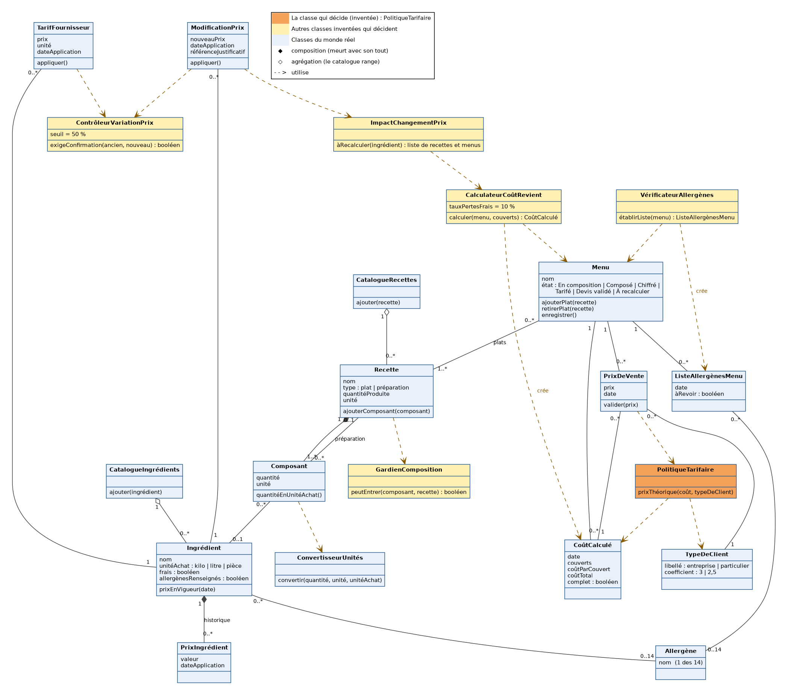
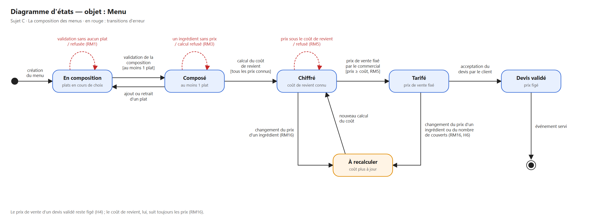
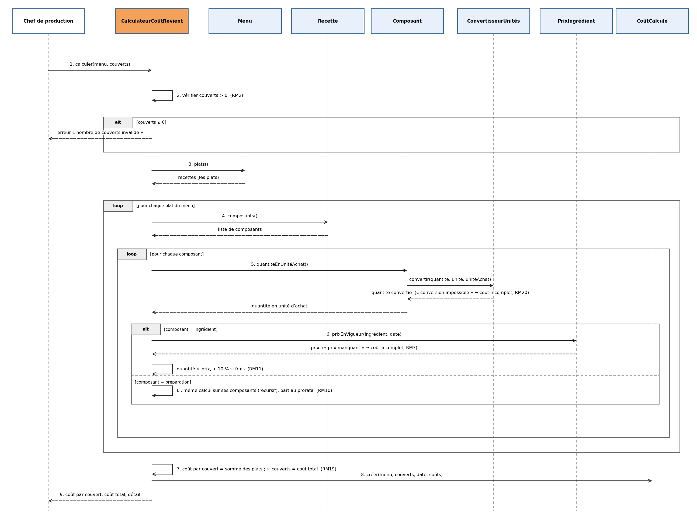

# TD 2 · Modèle — Sujet C : La composition des menus

> **Livrable 2.** Un seul fichier, dans le dépôt GitLab de l'équipe, avec les images des diagrammes dans le dossier `diagrammes/`.
> **À pousser avant le dimanche 8 novembre à 23h59.**
> En cas de problème GitLab : ce fichier et ses images par mail, avant la même heure.
> Si ce n'est pas demandé dans ce modèle, ce n'est pas demandé.

---

## 1. Les cartes CRC

*Une carte par classe, sans doublon. La responsabilité tient en une phrase, sans « et ». Chaque règle métier (RM) de votre livrable 1 est portée par une classe. Copiez le modèle de carte autant de fois que nécessaire.*

### Menu

| Responsabilité | Collaborateurs |
|---|---|
| Connaître sa suite de plats, en refusant d'être enregistré sans aucun plat. | Recette |

**Règles portées :** RM1

---

### PolitiqueTarifaire *(classe inventée : elle décide)*

| Responsabilité | Collaborateurs |
|---|---|
| Décider du prix de vente théorique d'un menu en appliquant au coût de revient total le coefficient du type de client. | CoûtCalculé, TypeDeClient |

**Règles portées :** RM4

---

### TypeDeClient

| Responsabilité | Collaborateurs |
|---|---|
| Connaître le coefficient de marge d'un type de client (× 3 pour une entreprise, × 2,5 pour un particulier). | PolitiqueTarifaire |

**Règles portées :** —

---

### PrixDeVente

| Responsabilité | Collaborateurs |
|---|---|
| Garder le prix de vente final retenu pour un menu et un type de client, en refusant tout prix inférieur au coût de revient. | Menu, TypeDeClient, PolitiqueTarifaire, CoûtCalculé |

**Règles portées :** RM5

### Ingrédient

| Responsabilité | Collaborateurs |
|---|---|
| Décrire un produit acheté chez un fournisseur, tel qu'on l'utilise en cuisine. | PrixIngrédient, Allergène, CatalogueIngrédients |

**Règles portées :** RM14, RM18

---

### PrixIngrédient

| Responsabilité | Collaborateurs |
|---|---|
| Garder un prix d'achat valable à partir d'une date donnée. | Ingrédient |

**Règles portées :** RM13, RM15

---

### Allergène

| Responsabilité | Collaborateurs |
|---|---|
| Représenter une des 14 substances réglementaires à signaler au client. | Ingrédient, ListeAllergènesMenu |

**Règles portées :** RM23

---

### CatalogueIngrédients

| Responsabilité | Collaborateurs |
|---|---|
| Refuser un nouvel ingrédient dont le nom est déjà pris. | Ingrédient |

**Règles portées :** RM17

---

### ConvertisseurUnités

| Responsabilité | Collaborateurs |
|---|---|
| Ramener une quantité dans l'unité d'achat de l'ingrédient. | Ingrédient, Composant |

**Règles portées :** RM20

---

### CalculateurCoûtRevient *(classe inventée, c'est elle qui décide)*

| Responsabilité | Collaborateurs |
|---|---|
| Décider du coût de revient d'un menu pour un nombre de couverts. | Menu, Recette, Composant, PrixIngrédient, ConvertisseurUnités, CoûtCalculé |

**Règles portées :** RM2, RM3, RM11, RM19

---

### CoûtCalculé

| Responsabilité | Collaborateurs |
|---|---|
| Mémoriser le résultat d'un calcul de coût à une date donnée. | Menu, CalculateurCoûtRevient |

**Règles portées :** —

---

### Recette

| Responsabilité | Collaborateurs |
|---|---|
| Décrire un plat (pour une portion) ou une préparation (pour une quantité produite) par la liste de ses composants. | Composant, CatalogueRecettes, GardienComposition |

**Règles portées :** RM6, RM12

---

### Composant

| Responsabilité | Collaborateurs |
|---|---|
| Indiquer quelle quantité d'un ingrédient ou d'une préparation entre dans une recette. | Recette, Ingrédient, ConvertisseurUnités |

**Règles portées :** RM8, RM10

---

### CatalogueRecettes

| Responsabilité | Collaborateurs |
|---|---|
| Refuser une nouvelle recette dont le nom est déjà pris. | Recette |

**Règles portées :** RM9

---

### GardienComposition *(classe inventée, c'est elle qui décide)*

| Responsabilité | Collaborateurs |
|---|---|
| Décider si un composant peut entrer dans une recette sans que la recette finisse par se contenir elle-même. | Recette, Composant |

**Règles portées :** RM7

---

### TarifFournisseur

| Responsabilité | Collaborateurs |
|---|---|
| Porter un nouveau prix transmis par le fournisseur pour un ingrédient, avec sa date d'application. | Ingrédient, PrixIngrédient, CatalogueIngrédients |

**Règles portées :** —

---

### ImpactChangementPrix *(classe inventée, c'est elle qui décide)*

| Responsabilité | Collaborateurs |
|---|---|
| Décider quelles préparations, quels plats et quels menus doivent être recalculés après un changement de prix. | Ingrédient, Composant, Recette, Menu, CalculateurCoûtRevient |

**Règles portées :** RM16

---

### ListeAllergènesMenu

| Responsabilité | Collaborateurs |
|---|---|
| Garder la liste datée des allergènes d'un menu, telle qu'elle est remise au client. | Menu, Allergène, VérificateurAllergènes |

**Règles portées :** RM24

---

### VérificateurAllergènes *(classe inventée, c'est elle qui décide)*

| Responsabilité | Collaborateurs |
|---|---|
| Décider si la liste des allergènes d'un menu est complète pour être remise au client. | Menu, Recette, Composant, Ingrédient, ListeAllergènesMenu |

**Règles portées :** RM21, RM22

---

### ModificationPrix

| Responsabilité | Collaborateurs |
|---|---|
| Porter un nouveau prix saisi à la main par le Chef, avec la référence de son justificatif. | Ingrédient, PrixIngrédient, ContrôleurVariationPrix, ImpactChangementPrix, TarifFournisseur |

**Règles portées :** RM25

---

### ContrôleurVariationPrix *(classe inventée, c'est elle qui décide)*

| Responsabilité | Collaborateurs |
|---|---|
| Décider si un nouveau prix s'écarte trop de l'ancien pour être appliqué sans vérification. | PrixIngrédient, ModificationPrix, TarifFournisseur |

**Règles portées :** RM26

---

## 2. Le diagramme de classes

*Chaque carte devient une classe : attributs, méthodes, relations, cardinalités. Ce qui n'est sur aucune carte n'existe pas dans le diagramme. Dans le doute, une association plutôt qu'un héritage.*

**La classe qui décide :** *mettez-la en évidence sur le diagramme (une couleur), puis répondez en deux lignes.*

- **Laquelle :** PolitiqueTarifaire (en orange sur le diagramme).
- **Quelle règle elle porte, et pourquoi elle n'existe pas dans le monde réel :** Elle porte RM4 : le prix de vente théorique d'un menu est son coût de revient total multiplié par le coefficient du type de client (× 3 pour une entreprise, × 2,5 pour un particulier). Aucun objet de la cuisine ne tient cette règle : le Menu ne connaît pas les clients, TypeDeClient connaît seulement son coefficient, et le Commercial est une personne, pas une classe du modèle. La cliente n'a pas tranché les remises, donc cette règle va changer.

---

## 3. Le diagramme d'états

*L'objet qui change d'état au fil du temps dans votre sujet. 3 à 6 états, avec des noms du métier. Chaque transition porte l'événement qui la déclenche. Au moins une transition d'erreur.*

**Objet choisi :** le **Menu**. On le compose, on calcule son coût, le commercial le tarife, puis il devient un devis validé. Un changement de prix d'ingrédient le fait revenir en arrière (RM16).

| État | Ce que ça veut dire dans le métier |
|---|---|
| En composition | Le chef choisit les plats du menu. |
| Composé | Le menu a au moins un plat (RM1). |
| Chiffré | Son coût de revient est calculé pour le nombre de couverts (RM19). |
| Tarifé | Le commercial a fixé le prix de vente selon le type de client (RM4, RM5). |
| Devis validé | Le client a accepté le devis : le prix de vente est figé (H4). |
| À recalculer | Le prix d'un ingrédient ou le nombre de couverts a changé : le coût n'est plus à jour (RM16, H6). |

**Transitions d'erreur (en rouge) :** validation d'un menu sans plat refusée (RM1), calcul refusé quand un ingrédient n'a pas de prix (RM3), prix de vente sous le coût de revient refusé (RM5).

*Source modifiable dans draw.io : `diagrammes/etats.drawio`.*

---

## 4. La séquence, version classes

*Le diagramme de séquence de votre livrable 1, refait avec les classes de votre modèle. Une classe qui envoie huit messages d'affilée porte trop de logique.*

**Use case :**UC4 — Calculer le coût de revient d'un menu

---

## 5. Use case → classes

*Chacun, pour ses 2 use cases : les classes qui y participent, et ce que fait chacune.*

| Use case | Porteur | Classes qui participent | Ce que fait chaque classe |
|---|---|---|---|
| UC1 | Manele Hssini | CatalogueIngrédients, Ingrédient, PrixIngrédient, Allergène | CatalogueIngrédients vérifie que le nom n'est pas déjà pris. Ingrédient garde l'unité d'achat, le caractère frais et les allergènes. PrixIngrédient enregistre le premier prix avec sa date. Allergène fournit la liste des 14 à cocher. |
| UC4 | Manele Hssini | CalculateurCoûtRevient, Menu, Recette, Composant, ConvertisseurUnités, PrixIngrédient, CoûtCalculé | CalculateurCoûtRevient vérifie le nombre de couverts, applique les 10 % de pertes et fait le total. Menu donne ses plats. Recette et Composant donnent les quantités. ConvertisseurUnités ramène chaque quantité en kilo, litre ou pièce. PrixIngrédient donne le prix du jour. CoûtCalculé garde le résultat pour le Commercial. |
| UC5 | Tania Hussain | VérificateurAllergènes, Menu, Recette, Composant, Ingrédient, Allergène, ListeAllergènesMenu | VérificateurAllergènes descend dans chaque plat et refuse la liste si un ingrédient n'a pas ses allergènes. Menu donne ses plats. Recette et Composant donnent ce qui entre dans chaque plat. Ingrédient donne ses allergènes. Allergène limite aux 14 réglementaires. ListeAllergènesMenu garde la liste validée avec sa date. |
| UC6 | Mohamed Amine BARCHAH | Menu, Recette | Menu garde la suite de plats choisis et refuse d'être enregistré sans aucun plat. Recette fournit les plats disponibles à sélectionner. |
| UC7 | Tania Hussain | ModificationPrix, Ingrédient, PrixIngrédient, ContrôleurVariationPrix, ImpactChangementPrix | ModificationPrix porte le nouveau prix et la référence de la facture. PrixIngrédient vérifie la date et garde l'ancien prix. ContrôleurVariationPrix demande une confirmation si l'écart dépasse 50 %. ImpactChangementPrix donne la liste des plats et menus à recalculer. |
| UC8 | Mohamed Amine BARCHAH | CalculateurCoûtRevient, CoûtCalculé, Menu, TypeDeClient, PolitiqueTarifaire, PrixDeVente | CalculateurCoûtRevient vérifie le nombre de convives, refuse le calcul si un ingrédient n'a pas de prix, et donne le coût de revient total. CoûtCalculé garde ce coût pour le Commercial. Menu donne ses plats au calcul. TypeDeClient donne le coefficient (× 3 ou × 2,5). PolitiqueTarifaire applique ce coefficient au coût pour obtenir le prix théorique. PrixDeVente garde le prix final choisi et refuse un prix inférieur au coût de revient. |

---

## 6. Nos décisions de conception

*2 ou 3 décisions. Format : « Nous avons choisi… plutôt que… parce que… ».*

| # | Nous avons choisi… | plutôt que… | parce que… |
|---|---|---|---|
| D1 | une classe PolitiqueTarifaire qui calcule le prix de vente théorique | de calculer le prix dans Menu | le Menu ne connaît pas les clients, et la cliente n'a pas tranché la forme des remises : la règle de prix doit pouvoir changer sans toucher au Menu. |
| D2 | une classe TypeDeClient qui porte son coefficient (× 3 entreprise, × 2,5 particulier) | d'écrire ces deux nombres dans PolitiqueTarifaire avec un « si entreprise, sinon particulier » | ajouter un type de client ou changer un coefficient devient une modification d'une ligne de données, sans retoucher la politique. |
| D3 | de contrôler « prix final ≥ coût de revient » dans PrixDeVente | de le contrôler dans PolitiqueTarifaire | PolitiqueTarifaire ne produit qu'un prix théorique, que le Commercial peut ajuster à la main ; l'interdiction de vendre à perte doit s'appliquer au prix retenu. |

---

## 7. La carte des changements

*3 à 5 changements probables. Chacun cite son indice, dans le sujet ou dans les réponses de la cliente. Sans indice, ce n'est pas un changement probable.*

| # | Ce qui peut changer | L'indice | Où dans le modèle |
|---|---|---|---|
| C1 | La forme des remises aux gros clients (pourcentage ou prix négocié par client) | « Les remises aux gros clients ne sont pas décidées » (réponse de la cliente à Q7), et la question reste ouverte en partie 10 | PolitiqueTarifaire, TypeDeClient |
| C2 | Le prix d'un devis déjà validé bouge ou non si un prix d'ingrédient change | La cliente dit que le coût change avec les prix, mais ne dit rien des devis déjà envoyés (H4 reste ouverte en partie 10) | PrixDeVente |
| C3 | Le nombre de couverts peut changer après la validation du menu | Aucune réponse de la cliente à Q6 (H6 reste ouverte) | CoûtCalculé, PrixDeVente, Menu |

---

*© 2026 Kawtar LAHMINI · Conception d'application · 4A ESIEA · Tous droits réservés*
