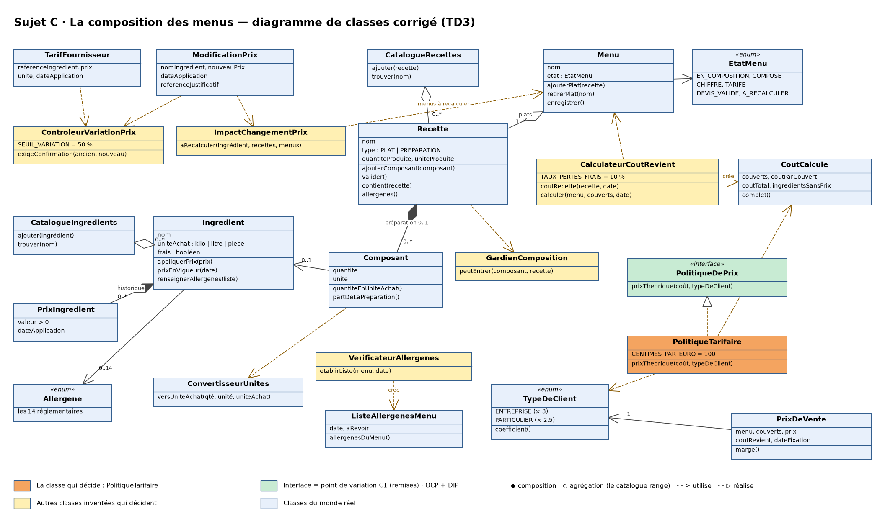

# TD 3 · Coder votre modèle — Sujet C : La composition des menus

> **Livrable 3.** Code final et présentation poussés avant le **vendredi 13 novembre à 12h00**.
> Projet Java 21 / Maven, rangé en `domaine/`, `persistance/`, `console/`.

---

## 1. Revision : de la carte des changements au point de variation (exercice 1)

*Pour chaque ligne de la carte des changements (TD2, partie 7) : une interface, ou rien ? 1 ou 2 interfaces au maximum.*

| # | Changement probable | Interface ou rien ? | Pourquoi (principe + indice) |
|---|---|---|---|
| C1 | La forme des remises aux gros clients | **Interface `PolitiqueDePrix`**, implémentée par `PolitiqueTarifaire` | **OCP + DIP.** Indice : « les remises aux gros clients ne sont pas décidées » (réponse à Q7). `FixerPrixDeVente` ne connaît que l'interface : une `PolitiqueAvecRemise` s'ajoutera comme une nouvelle classe, sans toucher au use case ni au Menu. |
| C2 | Le prix d'un devis validé bouge ou non | **Rien** | Le `PrixDeVente` garde son propre montant et son coût de revient du jour : il ne se recalcule jamais tout seul. Si la cliente veut qu'il bouge, c'est une règle de plus dans `PrixDeVente`, pas une famille de comportements. Pas d'indice d'une 2ᵉ variante. |
| C3 | Le nombre de couverts change après validation | **Rien** | Le nombre de couverts est déjà un paramètre de `CalculateurCoutRevient.calculer(menu, couverts, date)` : on relance le calcul, le menu passe « À recalculer ». Aucune abstraction à ajouter (YAGNI). |
| C4 | Le fournisseur envoie aussi les allergènes | **Rien** | L'indice vient de l'équipe jumelle, pas de la cliente (Q8 sans réponse). Ce serait un champ de plus dans `TarifFournisseur` : une interface maintenant serait de la complexité inutile. |

Les interfaces `IngredientRepository`, `RecetteRepository`, `MenuRepository` et `PrixDeVenteRepository` ne viennent pas de la carte : ce sont les contrats de stockage imposés par le découpage en 3 dossiers (**DIP** : le domaine ne dépend pas de la base).

**Diagramme de classes corrigé** (la classe qui décide en orange, l'interface en vert) :



*Source texte : `diagrammes/classes-td3.puml` (PlantUML). Le diagramme du TD2 reste dans `diagrammes/classes.png`.*

---

## 2. Ranger son code en trois dossiers (exercice 2)

```
src/main/java/fr/esiea/menus/
├── domaine/       le cœur : classes métier, classes qui décident, use cases, interfaces Repository
├── persistance/   *RepositoryMemoire (tests, démarrage) et *RepositoryJdbc (PostgreSQL, schema.sql)
└── console/       Main (crée la connexion), MenuConsole (un choix = un use case), données de démo
```

Le piège est vérifié : **aucun import de `persistance` ni de `console` dans `domaine`**, pas de SQL, pas de `System.out` dans une classe métier.

---

## 3. Clean code : la méthode à nettoyer

Les 7 problèmes de `Mgr.calc(String p, double d)` : le nom `Mgr` ; les noms `calc`, `p`, `d` ; des textes « E », « P » au lieu d'un type ; des `if` imbriqués ; les valeurs magiques 0.1 et 0.2 ; la variable `r` inutile ; le commentaire `// tarif`.

Dans notre code, les mêmes règles appliquées à la classe qui décide :

```java
public class PolitiqueTarifaire implements PolitiqueDePrix {
    private static final double CENTIMES_PAR_EURO = 100;            // pas de valeur magique

    @Override
    public double prixTheorique(CoutCalcule cout, TypeDeClient typeDeClient) {   // noms qui disent l'intention
        if (!cout.complet()) {                                       // return/throw dès que la réponse est connue
            throw new RegleMetierException("RM3", "prix manquant …");
        }
        return arrondiAuCentime(cout.coutTotal() * typeDeClient.coefficient());  // un type, pas un texte
    }
}
```

---

## 4. La classe qui décide, testée (exercice 4)

**`PolitiqueTarifaire`** — RM4 : prix de vente théorique = coût de revient total × coefficient du type de client (× 3 entreprise, × 2,5 particulier).

| Cas | Test (`PolitiqueTarifaireTest`) | Attendu |
|---|---|---|
| Normal | `uneEntreprisePaieTroisFoisLeCoutDeRevient` | 1 000 € → 3 000 € |
| Limite | `unParticulierPaieDeuxFoisEtDemieArrondiAuCentime` | 33,333 € → 83,33 € |
| Erreur | `unCoutIncompletEmpecheDeFixerUnPrix` | `RegleMetierException` RM3 |

Les trois cas du sujet C de l'énoncé sont aussi testés (`VerificateurAllergenesTest`) : allergène dans une sous-préparation, menu sans aucun allergène, préparation qui se contient elle-même (RM7).

---

## 5. Les use cases, du menu à la règle métier

| UC | Porteur | Choix du menu | Classe du use case (`domaine/`) | Règles | Tests |
|---|---|---|---|---|---|
| UC1 Enregistrer un ingrédient | Manele HSSINI | 1 | `EnregistrerIngredient` | RM13, RM14, RM17, RM18 | `EnregistrerIngredientTest` |
| UC2 Composer une recette | **Abir GUEBBACHE** | 2 | `ComposerRecette` → `Recette`, `Composant`, `GardienComposition`, `CalculateurCoutRevient` | RM6 à RM12 | `ComposerRecetteTest` (9 tests) |
| UC3 Mettre à jour le prix d'un ingrédient | **Abir GUEBBACHE** | 3 | `MettreAJourPrixIngredient` → `TarifFournisseur`, `PrixIngredient`, `ControleurVariationPrix`, `ImpactChangementPrix` | RM13 à RM16 | `MettreAJourPrixIngredientTest` (8 tests) |
| UC4 Calculer le coût de revient d'un menu | Manele HSSINI | 4 | `CalculerCoutMenu` → `CalculateurCoutRevient` | RM2, RM3, RM10, RM11, RM19, RM20 | `CalculerCoutMenuTest` |
| UC5 Établir la liste des allergènes | Tania HUSSAIN | 5 | `EtablirAllergenesMenu` → `VerificateurAllergenes` | RM1, RM12, RM21, RM22 | `EtablirAllergenesMenuTest` |
| UC6 Composer un menu | Mohamed Amine BARCHAH | 6 | `ComposerMenu` → `Menu` | RM1 | `ComposerMenuTest` |
| UC7 Modifier le prix d'un ingrédient | Tania HUSSAIN | 7 | `ModifierPrixIngredient` → `ModificationPrix`, `ControleurVariationPrix` | RM13, RM15, RM16, RM25, RM26 | `ModifierPrixIngredientTest` |
| UC8 Fixer le prix de vente d'un menu | Mohamed Amine BARCHAH | 8 | `FixerPrixDeVente` → `PolitiqueDePrix`, `PrixDeVente` | RM2, RM3, RM4, RM5 | `FixerPrixDeVenteTest` |

**64 tests verts** (`mvn test`) : domaine, Repository JDBC sur H2 avec le vrai `schema.sql`, et menu console piloté par une saisie scriptée (y compris des saisies absurdes). Couverture JaCoCo : domaine 96 %, persistance 99 %.

---

## 6. La base et le menu

- **Domaine** : 4 interfaces `*Repository`. **Persistance** : une version mémoire et une version JDBC de chacune, avec `src/main/resources/schema.sql` (contraintes `CHECK` pour RM2, RM5, RM8, RM13).
- **Main** : crée la connexion PostgreSQL et la passe aux constructeurs. Si la base est injoignable, l'application démarre en mémoire (pratique en démo). Option `--memoire` pour forcer la mémoire.
- **Menu console** : un choix = un use case ; il ne calcule rien lui-même et survit à une saisie absurde (« Choix inconnu », « n'est pas un nombre », refus des règles métier affichés sans planter).

---

## 7. Lancer le projet

```bash
docker compose up -d                 # PostgreSQL 16 sur localhost:5432 (base/utilisateur/mot de passe : menus)
mvn test                             # 64 tests
mvn -q compile exec:java             # l'application (données de démo chargées si la base est vide)
mvn -q compile exec:java -Dexec.args="--memoire"   # sans base
```

Autre base : variables `MENUS_DB_URL`, `MENUS_DB_USER`, `MENUS_DB_PASSWORD`.
Sous Windows, si les accents s'affichent mal : `chcp 65001` avant de lancer.

---

*© 2026 Kawtar LAHMINI · Conception d'application · 4A ESIEA · Tous droits réservés*
